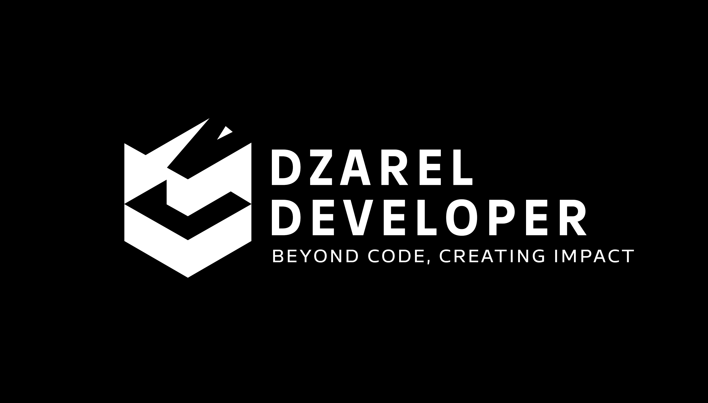
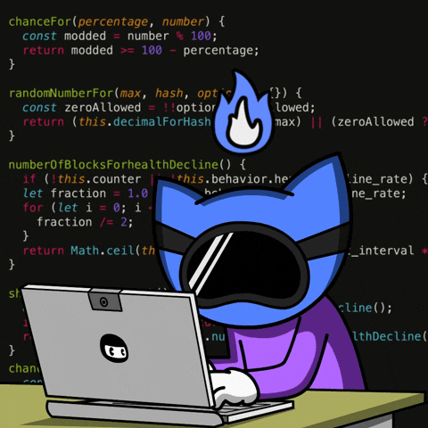

<!-- ── Banner ───────────────────────────────────────────── -->

#### *Beyond Code, Creating Impact*

  
  
  
  
  
  

---

<!-- ── About ────────────────────────────────────────────── -->
<h2>About Me</h2>

Hey, **I'm Muhamad Dzarel Alghifari — a Software Developer known as DzarelDeveloper.**

I build **secure, user-focused software applications** end to end — from frontend architecture with **React and Next.js** to backend services using **Node.js, PHP, and Python**, backed by **MySQL**. I take a product-driven approach: build real applications, test them under real-world conditions, and continuously improve them.

My experience in software development, testing, security monitoring, and authorized web application security assessments has shaped how I build software — **validation, access control, and secure architecture are requirements, not afterthoughts.**

Beyond individual projects, I build technology initiatives through **CodeSphere**, a developer community, and **Zyra Network**, a web development and digital services initiative.

- Currently building **SEI — Self Exploration Intelligence**
- Exploring **Application Security, System Design, and Software Architecture**
- Ask me about **React, Next.js, TypeScript, and Node.js**
- Reach me at [**dzarelalghifari123@gmail.com**](mailto:dzarelalghifari123@gmail.com)
- Open to **internships, freelance projects, collaborations, and junior software development opportunities**

---

<!-- ── Featured Projects ─────────────────────────────────── -->
<h2>Featured Projects</h2>

### [SEI — Self Exploration Intelligence](https://github.com/DzarelDeveloper/sei)

> Client-only web app helping **SMP / SMA / SMK students** recognize their interests and explore education pathways — with evidence-backed recommendations.

  
  
  
  
  

**[Live Demo](https://sei-explore.netlify.app) · [Repository](https://github.com/DzarelDeveloper/sei)**

### [VibeRepo](https://github.com/DzarelDeveloper/VibeRepo)

> Turns any public GitHub repository into a clear, build-ready blueprint — generating a complete handoff package in minutes.

  
  
  
  

**[Repository](https://github.com/DzarelDeveloper/VibeRepo)**

---

<!-- Snake Animation - TOP ONLY -->

  

<!-- Profile Counters with Neon Effect -->
<!-- 

  
  
  

 -->

---

  

<!-- Animated Connector Lines -->

  

<!-- Social Links with GIF Side by Side -->

  <table style="border-collapse: collapse; margin: 20px auto;">
    <tr>
      <td style="padding: 20px; vertical-align: middle;">
        <!-- Party Animation GIF -->
        
      </td>
      <td style="padding: 20px; vertical-align: middle;">
        <!-- Social Links Table -->
        <table style="border-collapse: collapse;">
          <tr>
            <td style="padding: 8px;">
              
            </td>
            <td style="padding: 8px;">
              
            </td>
          </tr>
          <tr>
            <td style="padding: 8px;">
              
            </td>
            <td style="padding: 8px;">
              
            </td>
          </tr>
          <tr>
            <td colspan="2" style="padding: 8px; text-align: center;">
              
            </td>
          </tr>
        </table>
      </td>
    </tr>
  </table>

<!-- Call to Action -->

  

<!-- Decorative Footer -->

  

---

## 📊 **GitHub Analytics - Data Visualization**

  <picture>
    <source media="(prefers-color-scheme: dark)" srcset="https://github-profile-summary-cards.vercel.app/api/cards/stats?username=DzarelDeveloper&theme=github_dark">
    <source media="(prefers-color-scheme: light)" srcset="https://github-profile-summary-cards.vercel.app/api/cards/stats?username=DzarelDeveloper&theme=github">
    
  </picture>
  <picture>
    <source media="(prefers-color-scheme: dark)" srcset="https://github-profile-summary-cards.vercel.app/api/cards/repos-per-language?username=DzarelDeveloper&theme=github_dark">
    <source media="(prefers-color-scheme: light)" srcset="https://github-profile-summary-cards.vercel.app/api/cards/repos-per-language?username=DzarelDeveloper&theme=github">
    
  </picture>

  <picture>
    <source media="(prefers-color-scheme: dark)" srcset="https://streak-stats.demolab.com?user=DzarelDeveloper&theme=dark&hide_border=true">
    <source media="(prefers-color-scheme: light)" srcset="https://streak-stats.demolab.com?user=DzarelDeveloper&theme=default&hide_border=true">
    
  </picture>

---

<!-- 

  

 -->

---
<!-- STATS -->
&nbsp;

  <h2><i>Contribution Activity 📈</i></h2>
  <a href="https://github.com/DzarelDeveloper">
    <picture>
      <source media="(prefers-color-scheme: dark)" srcset="https://github-profile-summary-cards.vercel.app/api/cards/profile-details?username=DzarelDeveloper&theme=github_dark">
      <source media="(prefers-color-scheme: light)" srcset="https://github-profile-summary-cards.vercel.app/api/cards/profile-details?username=DzarelDeveloper&theme=github">
      
    </picture>
  </a>

---
🌟 Quest Harian 🌟

> "Belajar bukan beban, tapi tiket keluar dari kebingungan."
---

<!-- Winter Themed Sign Off -->

  

